# Microsoft Sentinel SOC Lab

**Build a SIEM. Write detections. Attack it. Prove the detections work. Automate the response.**

A hands-on Security Operations lab on Microsoft Azure. I deployed Microsoft Sentinel and two monitored servers entirely with Terraform, wrote seven KQL detection rules mapped to MITRE ATT&CK, tested each one by performing the behaviour it should catch, investigated the resulting incidents, fixed the problems testing exposed, and automated triage and alerting.

📄 **Write-ups:** [Detection validation report](DETECTION-VALIDATION.md) · [Incident report IR-001](reports/IR-001-admin-group-add.md)

---

## Results at a glance

| | |
|---|---|
| Detection rules (KQL, as code) | **7**, mapped to MITRE ATT&CK |
| Rules validated by live testing | **6 of 7** (1 documented data-source gap) |
| Problems found and fixed through testing | **3**: duplicate alerts, a false negative, a late-data blind spot |
| Time from attack to email alert | **~12 minutes**, fully automated |
| Infrastructure in Terraform | **100%**: workspace, Sentinel, VMs, agents, rules, automation |
| Cost controls | $10 budget, 1 GB/day ingestion cap, nightly auto-shutdown |

---

## Architecture

```
            France Central                                   Austria East
 ┌─────────────────────────────────────────┐     ┌──────────────────────────────────┐
 │  Log Analytics workspace + Sentinel     │     │  vnet-soc-lab (10.10.0.0/16)     │
 │   ├─ 7 scheduled analytics rules        │     │   NSG: RDP/SSH from my IP only   │
 │   ├─ Automation rule: auto-triage High  │◄────┤   ├─ win-soc-01  Windows 2022    │
 │   └─ Data collection rules              │ AMA │   └─ lnx-soc-01  Ubuntu 24.04    │
 │  Azure Monitor alert → email            │     │      (Azure Monitor Agent)       │
 │  Logic App: deallocate VMs at 22:00     │     └──────────────────────────────────┘
 │  Azure Activity log (subscription) ─────┼──► Sentinel
 └─────────────────────────────────────────┘
```

**Log sources:** Windows Security events (`SecurityEvent`), Windows PowerShell operational log, Linux auth logs (`Syslog`), and the Azure Activity log (`AzureActivity`).

**Why two regions:** the student subscription only had CPU quota for VM sizes that weren't offered in France Central. I checked available sizes and quota per region, placed the VMs where both existed, and kept the SIEM in France Central. Logs cross regions to a single workspace, as they would in a multi-region company.

---

## Detection rules

| Rule | Detects | MITRE ATT&CK | Severity |
|---|---|---|---|
| `win-brute-force` | 5+ failed logons to one account from one source in 15 min | T1110 | Medium |
| `win-new-local-user` | New local account created (4720) | T1136.001 | Medium |
| `win-admin-group-add` | Member added to local Administrators (4732, SID S-1-5-32-544) | T1098 | High |
| `win-security-log-cleared` | Security log cleared (1102) | T1070.001 | High |
| `linux-ssh-failed-logins` | 5+ failed SSH logins from one IP in 15 min | T1110 | Medium |
| `azure-nsg-change` | Cloud firewall (NSG) created, changed or deleted | T1562.007 | Medium |
| `azure-role-assignment` | Azure permissions granted or attempted | T1098 | Medium |

Each rule lives in its own `.kql` file in [`detections/`](detections/) with a header explaining what it catches and how to triage it, and is deployed by Terraform ([`terraform/detections.tf`](terraform/detections.tf)) with entity mapping (account, host, IP) so related incidents link together.

---

## What testing found (and how I fixed it)

Every rule was triggered on purpose. Three of the seven needed fixing:

1. **Duplicate alerts.** The two threshold rules raised **3 alerts per attack**, because they run every 5 minutes but look back 15. **Fix:** 15-minute alert suppression on those rules only, so a second, separate event on a single-event rule still alerts.
2. **A false negative.** The role-assignment rule never fired: the Activity log recorded a successful change as *Started → Failed*, and the rule only matched *Success*. **Fix:** match Success and Failure (a failed attempt to grant permissions is suspicious too).
3. **Late-arriving data.** A log-clear test produced no alert. Measuring `ingestion_time()` against `TimeGenerated` showed the event arrived **13 minutes late**, after every rule window covering it had already run. **Fix:** look back 1 hour but only keep rows ingested since the last run:
   ```kql
   SecurityEvent
   | where ingestion_time() > ago(5m)
   | where EventID == 1102
   ```
   Each event now alerts exactly once, however late it arrives. Retest: event to alert in about 9 minutes.

**Known gap:** across two tests the Azure Activity log failed to record role-assignment creation reliably (once as *Failed* although it succeeded, once not at all after 24 hours). The rule logic is correct; the data source isn't. Documented with a recommended mitigation: compare current role assignments against an approved baseline. Full details in [DETECTION-VALIDATION.md](DETECTION-VALIDATION.md).

---

## Investigation

[**IR-001**](reports/IR-001-admin-group-add.md) is a full write-up of the High-severity *member added to local Administrators* incident: timeline, KQL evidence, classification and lessons. The key step: the Windows events showed the change was made by `win-soc-01$` (SYSTEM), and only the Azure Activity log revealed **which person** triggered it through **Azure Run Command** (MITRE T1651). Host and cloud logs had to be correlated to answer *who did this?*

---

## Automation (SOAR)

| Automation | How |
|---|---|
| **Auto-triage:** every High incident is assigned to me and tagged `auto-triaged` / `priority-high` on creation | Sentinel automation rule |
| **Email alert** within minutes of a new High incident | Azure Monitor scheduled query on `SecurityIncident` + action group |
| **Nightly cost control:** both VMs deallocated at 22:00 | Logic App with a managed identity, scoped to *Virtual Machine Contributor* on the lab resource group only |

**Verified end to end:** Security log cleared at 11:49 → event ingested 11:50 → alert 11:58 → incident auto-assigned and tagged → email received 12:01.

---

## Screenshots

### Logs flowing: my own SSH session reconstructed in Sentinel
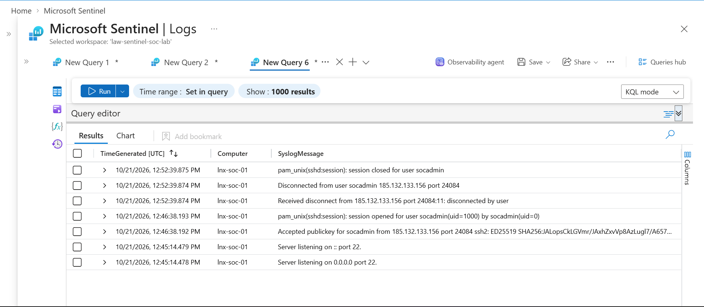

### Seven detection rules deployed as code
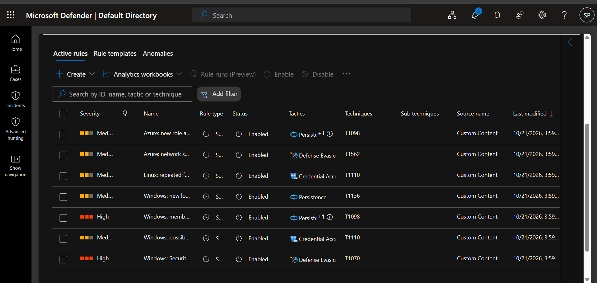

### Detections firing during testing
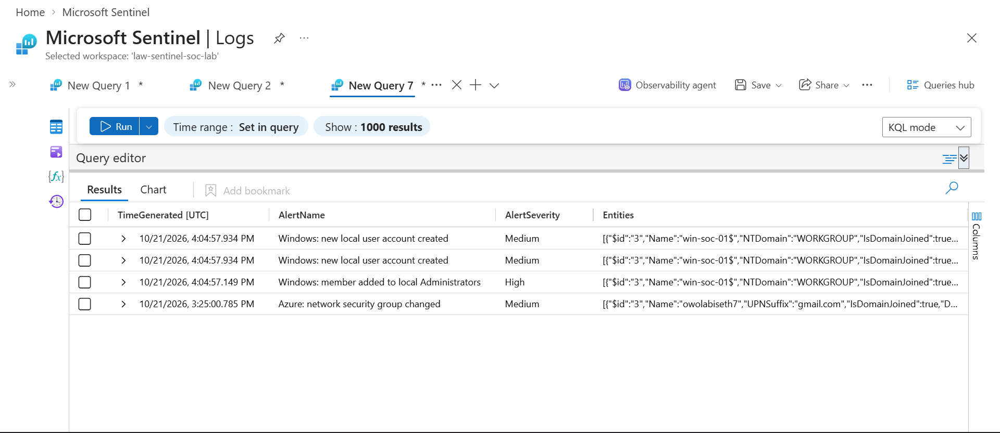

### Investigation: tracing a SYSTEM-level change to a person through Azure Run Command
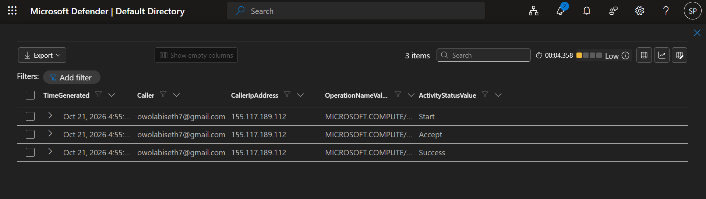

### Automation: incident assigned and tagged with no human involved
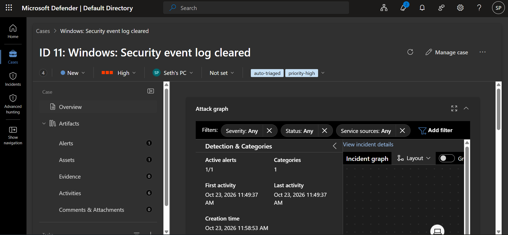

### Notification: email alert for a new High severity incident
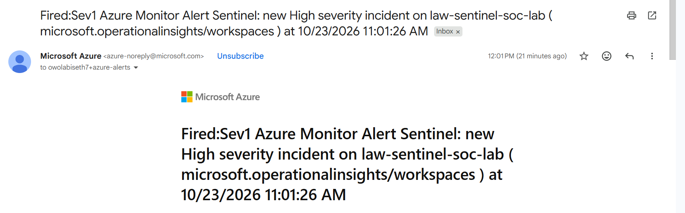

<details>
<summary>More screenshots</summary>

| | |
|---|---|
| 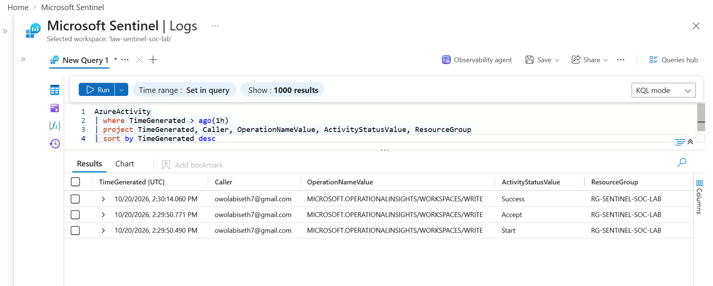 | 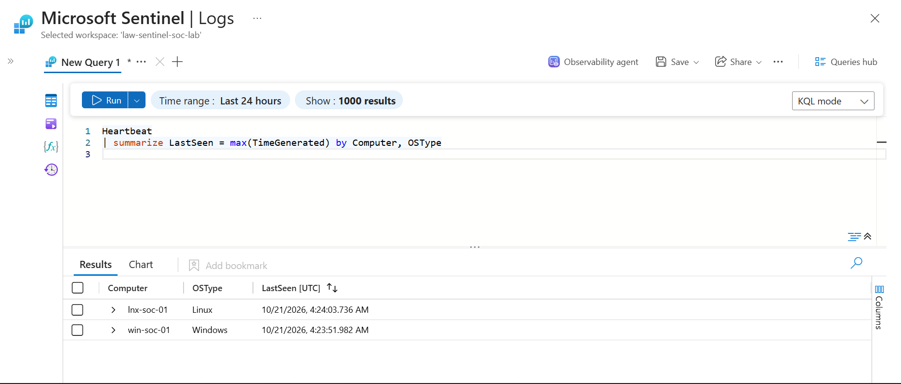 |
| 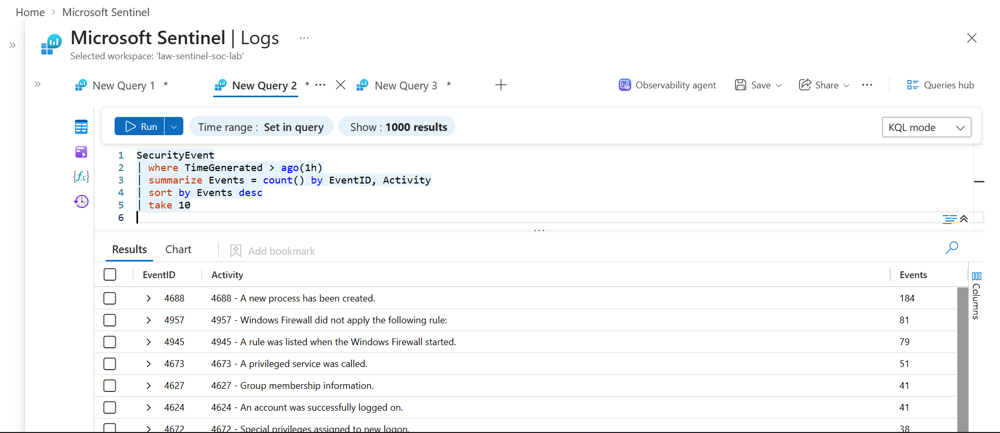 | 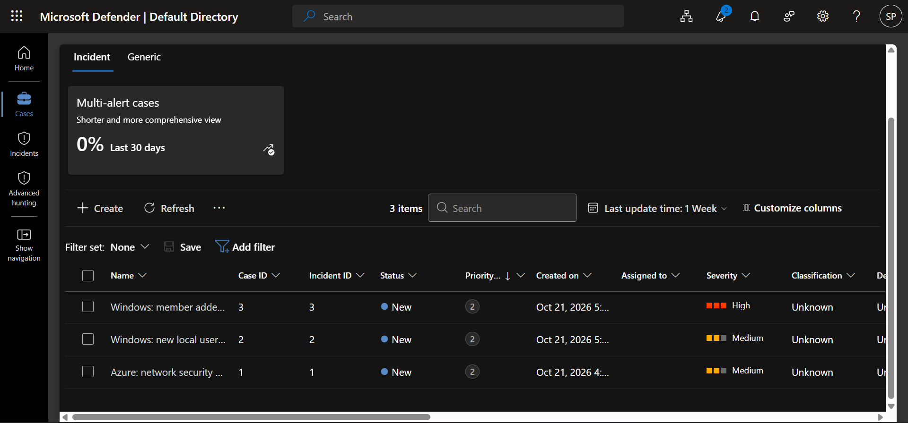 |
| 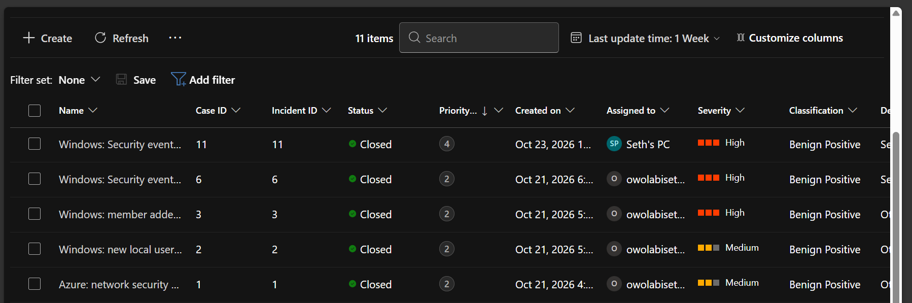 | |

</details>

---

## Tech stack

| Tool | Purpose |
|---|---|
| **Microsoft Sentinel** (Defender portal) | SIEM: analytics rules, incidents, automation |
| **KQL** | Detections, hunting, investigation, latency measurement |
| **Terraform** (azurerm 4.x) | All infrastructure, rules and automation as code |
| **Azure Monitor Agent + data collection rules** | Log collection from Windows and Linux |
| **Azure Logic Apps** | Scheduled automation with a managed identity |
| **Azure Monitor alerts + action groups** | Email notification |
| **Git** | Every change versioned, one logical change per commit |

**Security practices used throughout**
- Admin ports (RDP/SSH) allowed only from my current IP; everything else blocked
- Linux: SSH key only, no passwords. Windows: 24-character password generated by Terraform, never typed or committed
- Trusted Launch (Secure Boot + vTPM) on both VMs
- Managed identities instead of stored credentials; least-privilege role for the automation
- Secrets and state kept out of Git (`.gitignore` excludes `*.tfvars`, state and plan files)
- MFA on the Azure account; every `terraform apply` ran a saved, reviewed plan

---

## Lessons learned

1. **Test every detection.** Three of seven rules had problems that only appeared when I triggered them.
2. **Measure, don't guess.** `ingestion_time()` vs `TimeGenerated` turned "the rule is broken" into "the data arrived 13 minutes late".
3. **When a rule doesn't fire, check each stage:** did it happen, was it logged, did it arrive, did the rule run?
4. **Correlate sources.** Host logs said *SYSTEM*; cloud logs said *who*.
5. **Identity beats IP.** Behind a VPN my IP changed between actions; the authenticated account was the reliable evidence.
6. **Read the plan, not just the summary.** A "7 to change" plan when I expected 2 came from an Azure default worth understanding before applying.
7. **Document gaps honestly.** A known, explained gap with a mitigation is more useful than a rule assumed to work.

---

## Repository contents

| Path | Contents |
|---|---|
| [`terraform/`](terraform/) | `main.tf` (workspace, Sentinel, Activity log), `vms.tf` (network, VMs, agents, collection rules, nightly shutdown), `detections.tf` (analytics rules), `automation.tf` (auto-triage, email alert) |
| [`detections/`](detections/) | One `.kql` file per rule, with triage notes |
| [`DETECTION-VALIDATION.md`](DETECTION-VALIDATION.md) | How each rule was tested, the tuning, the known gap |
| [`reports/`](reports/) | Incident report IR-001 and screenshots |

## Run it yourself

> Requires an Azure subscription and the Azure CLI. Check allowed regions, VM sizes **and** CPU quota for your subscription first: they can differ.

```bash
az login
cd terraform
cp terraform.tfvars.example terraform.tfvars   # subscription ID, your IP, alert email
terraform init
terraform plan -out=lab.tfplan                 # always review before applying
terraform apply lab.tfplan
terraform destroy                              # when finished
```

---

*Related projects: [AWS Cloud Security Posture Lab](https://github.com/naijadevseth/aws-cspm-lab) (misconfiguration detection with Checkov and Prowler, remediation as code) · [DevSecOps pipeline for OWASP Juice Shop](https://github.com/naijadevseth/juice-shop)*
